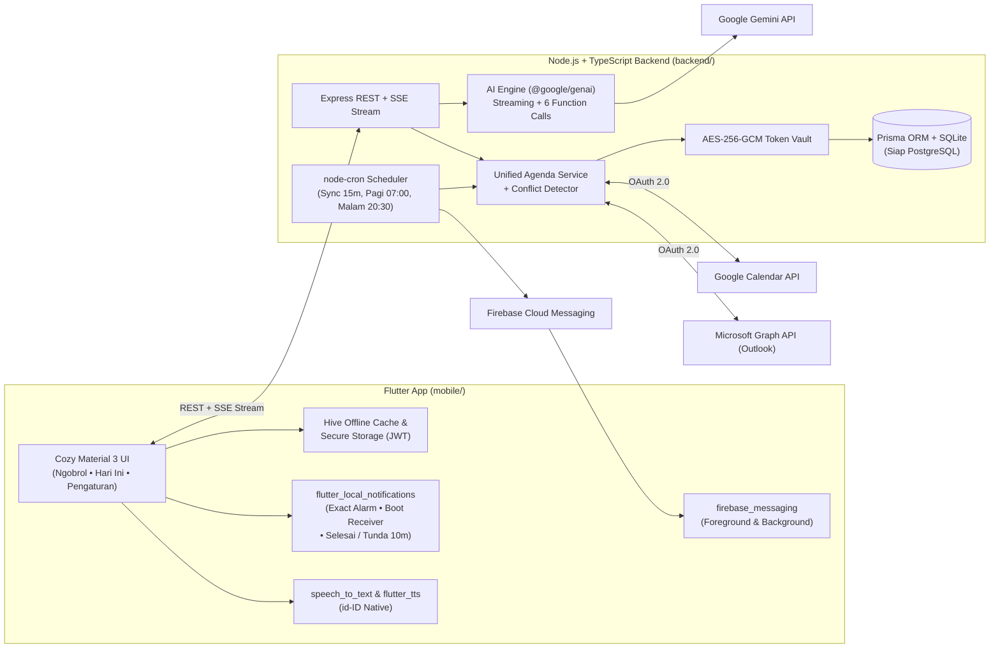

# TemanHari ☀️

Aplikasi mobile **Flutter (Android & iOS)** + **Backend Node.js (TypeScript)** yang menggabungkan:
1. **Teman Ngobrol AI Hangat & Empatik** (Gemini `@google/genai`, SSE Streaming, Memori Pribadi, Mood Check-in, Mode Suara `id-ID`, Guardrail Krisis),
2. **Pemberitahuan & Manajemen Tugas Harian Andal di Layar Mati** (`flutter_local_notifications` + `exactAllowWhileIdle` + `RECEIVE_BOOT_COMPLETED` + Tombol **Tandai Selesai** & **Tunda 10 Menit** + FCM Push + Jam Tenang),
3. **Integrasi Dua Arah Microsoft Outlook & Google Calendar** (OAuth 2.0 aman via backend, enkripsi token AES-256-GCM, auto refresh token, Unified Agenda, deteksi bentrok jadwal, serta Mode Demo siap coba).

---

## 1. Arsitektur Sistem



---

## 2. Panduan Konfigurasi Kredensial

> **Tips:** Aplikasi sudah mendukung **Mode Demo** bawaan. Tanpa mengisi satu pun API key, kamu tetap bisa langsung mencoba ruang obrolan AI fallback (termasuk membuat tugas dari obrolan!), jadwal simulasi Outlook + Google lengkap dengan deteksi bentrok, serta pengingat lokal layar mati.

### A. `GEMINI_API_KEY` (Google AI Studio)
1. Buka [Google AI Studio](https://aistudio.google.com/apikey) dan login dengan akun Google.
2. Klik **Create API key**, lalu salin key yang dihasilkan.
3. Tempel di `backend/.env`:
   ```env
   GEMINI_API_KEY=AIzaSy...
   GEMINI_MODEL=gemini-2.5-flash
   ```

### B. Google Calendar OAuth 2.0 (Google Cloud Console)
1. Buka [Google Cloud Console](https://console.cloud.google.com/) → buat/pilih Project.
2. Masuk ke **APIs & Services → Library**, cari dan aktifkan **Google Calendar API**.
3. Masuk ke **APIs & Services → OAuth consent screen**:
   - Pilih **External**, isi nama aplikasi `TemanHari`, tambahkan email Anda sebagai **Test user**.
   - Tambahkan scopes: `https://www.googleapis.com/auth/calendar.events`, `https://www.googleapis.com/auth/calendar.readonly`, `https://www.googleapis.com/auth/userinfo.email`.
4. Masuk ke **APIs & Services → Credentials → Create Credentials → OAuth client ID**:
   - Application type: **Web application**
   - Authorized redirect URIs:
     - Pengembangan lokal: `http://localhost:4000/api/calendar/google/callback`
     - HP fisik / produksi: `https://<domain-backend-anda>/api/calendar/google/callback`
5. Salin **Client ID** & **Client Secret** ke `backend/.env`:
   ```env
   GOOGLE_CLIENT_ID=xxxx.apps.googleusercontent.com
   GOOGLE_CLIENT_SECRET=GOCSPX-xxxx
   GOOGLE_REDIRECT_URI=http://localhost:4000/api/calendar/google/callback
   ```

### C. Microsoft Outlook OAuth 2.0 (Microsoft Entra ID / Azure Portal)
1. Buka [Microsoft Azure Portal](https://portal.azure.com/) → **Microsoft Entra ID → App registrations → New registration**.
2. Isi nama `TemanHari`, lalu pilih **Supported account types**:
   *Accounts in any organizational directory and personal Microsoft accounts (Outlook.com, Hotmail, Microsoft 365)*.
3. Pada **Redirect URI**, pilih platform **Web** dan masukkan:
   - `http://localhost:4000/api/calendar/microsoft/callback` (atau URL HTTPS backend Anda).
4. Setelah dibuat, buka **Certificates & secrets → New client secret**, lalu salin **Value** secret.
5. Buka **API permissions → Add a permission → Microsoft Graph → Delegated permissions**, tambahkan:
   - `offline_access`
   - `User.Read`
   - `Calendars.ReadWrite`
   - `Tasks.ReadWrite`
6. Salin ke `backend/.env`:
   ```env
   MICROSOFT_CLIENT_ID=<Application (client) ID>
   MICROSOFT_CLIENT_SECRET=<Client secret value>
   MICROSOFT_TENANT_ID=common
   MICROSOFT_REDIRECT_URI=http://localhost:4000/api/calendar/microsoft/callback
   ```

### D. Firebase Cloud Messaging (FCM)
1. Buka [Firebase Console](https://console.firebase.google.com/) → buat project `TemanHari`.
2. **Android:** Tambahkan aplikasi Android dengan package name `id.temanhari.temanhari`, unduh `google-services.json`, lalu letakkan di:
   - `mobile/android/app/google-services.json`
   *(File `build.gradle.kts` otomatis mengaktifkan plugin `google-services` saat file tersebut ada).*
3. **iOS:** Tambahkan aplikasi iOS dengan Bundle ID `id.temanhari.temanhari`, unduh `GoogleService-Info.plist`, lalu letakkan di:
   - `mobile/ios/Runner/GoogleService-Info.plist`
   Aktifkan juga capability **Push Notifications** & **Background Modes (Remote notifications)** di Xcode.
4. **Backend Service Account:** Di Firebase Console → **Project Settings → Service accounts → Generate new private key**. Simpan JSON tersebut misalnya di `backend/firebase-service-account.json`, lalu isi di `backend/.env`:
   ```env
   FIREBASE_SERVICE_ACCOUNT_PATH=./firebase-service-account.json
   ```

---

## 3. Cara Instalasi & Menjalankan

### 1) Jalankan Backend (`backend/`)
```bash
cd TemanHari/backend
cp .env.example .env
# (Opsional) Isi GEMINI_API_KEY, Google/Microsoft OAuth, atau Firebase di .env

npm install
npx prisma generate
npx prisma db push
npm run dev
```
Backend berjalan di `http://localhost:4000` (cek `GET http://localhost:4000/health`).

### 2) Jalankan Flutter di Android Emulator (`mobile/`)
```bash
cd TemanHari/mobile
flutter pub get
flutter run
```
Secara default di Android Emulator, aplikasi langsung mengarah ke `http://10.0.2.2:4000`.

### 3) Jalankan Flutter di HP Fisik Android (via USB / Wi-Fi LAN)
Pastikan HP dan komputer berada di jaringan Wi-Fi yang sama, cek IP LAN komputer (misal `192.168.1.15`), lalu jalankan:
```bash
cd TemanHari/mobile
flutter run --dart-define=API_BASE_URL=http://192.168.1.15:4000
```
Atau ubah langsung alamat server dari dalam aplikasi melalui **Pengaturan → Koneksi Server**.

> **Catatan Android 12/13/14+ untuk Notifikasi Layar Mati:**
> Setelah aplikasi terbuka di HP fisik, izinkan **Notifikasi** & **Alarm & Pengingat (Exact Alarm)**, dan disarankan setel baterai aplikasi TemanHari ke **Unrestricted / Tanpa Batasan** di pengaturan HP (terutama Xiaomi/OPPO/Vivo/Samsung) agar alarm tetap berbunyi tepat detik di layar mati.
